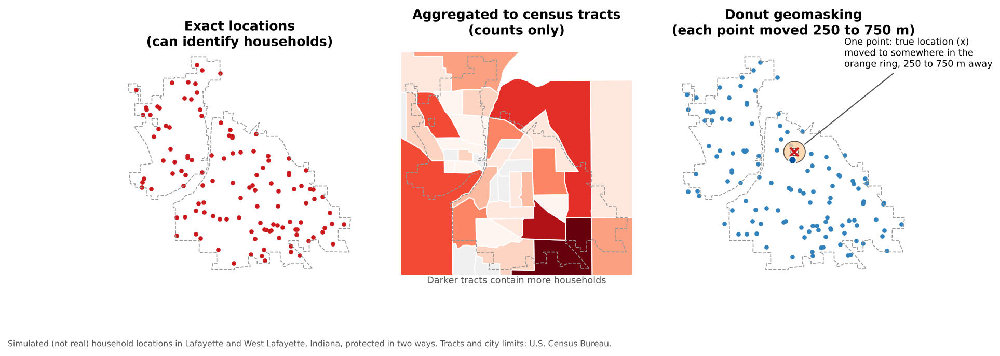

:::::::::::::::::::::::::::::::::::::: questions

- Why can location data identify people, even without names?
- How can geospatial data be shared while protecting privacy?
- What other kinds of location data are sensitive?
- What ethical and legal obligations apply?

::::::::::::::::::::::::::::::::::::::::::::::::

::::::::::::::::::::::::::::::::::::: objectives

- Explain how locations and small counts can re-identify people
- Describe aggregation, geomasking, coordinate coarsening and suppression, and their trade-offs
- Recognize sensitive locations beyond personal data, such as archaeological sites and places important to communities
- Plan consent, review and access controls for sensitive geospatial data

::::::::::::::::::::::::::::::::::::::::::::::::

## Location is personal

Removing names from a dataset does not make it anonymous if it contains **locations**. A home address, or a point
on a map that falls on one house, identifies a household as surely as a name. Combined with a few other details
(age, sex, the date of a visit), even approximate locations can single people out.

- In a widely cited study of mobile phone records for 1.5 million people, **four** points in space and time were
  enough to uniquely identify 95% of individuals (de Montjoye and colleagues, *Scientific Reports*, 2013).
- Maps of individual cases (illnesses, crimes, survey responses) have been used to find the people behind them.
- Small areas can reveal individuals through **small counts**: if a census block contains one household of a
  particular kind, a table for that block describes that household.

This is why the U.S. Census Bureau applies **disclosure avoidance** to everything it publishes. For the 2020
Census it adopted a method based on **differential privacy**, which adds carefully calibrated noise to published
counts, especially for small areas.

::::::::::::::::::::::::::::::::::::: callout

## Sensitive does not only mean personal

Some locations need protection even when no person is identified:

- **Archaeological sites**: published locations invite looting. U.S. federal law (including the Archaeological
  Resources Protection Act) allows agencies to withhold site locations.
- **Sacred and culturally significant places**: their location may be knowledge that a community does not wish
  to share (see the CARE principles in the previous episode).
- **Endangered species**: nest, den or plant locations can attract poachers or collectors.
- **Critical infrastructure** and **shelters** (for example, for survivors of domestic violence).

::::::::::::::::::::::::::::::::::::::::::::::::

## Methods for protecting locations

There is always a **trade-off** between protection and usefulness: the more a location is changed or hidden,
the safer it is, and the less precise the analysis it supports.

{alt="Three maps of Lafayette and West Lafayette with simulated household locations. Left: 120 red points at exact locations, which could identify households. Middle: the same points aggregated to census tracts, shaded from light to dark red by count, so only totals per tract are shown. Right: donut geomasking, where every point has been moved a random distance between 250 and 750 meters; one point's true location is marked with an x inside an orange ring showing the area its masked point could fall in."}

| Method | What it does | Strengths | Weaknesses |
|---|---|---|---|
| **Aggregation** | Report counts or rates for areas (tracts, ZIP codes, grid cells) instead of points | Simple, familiar, works with census data | Loses detail; results depend on the areas chosen; small areas can still disclose |
| **Geomasking** (random perturbation) | Move each point a random distance and direction | Keeps point patterns approximately | Points can land in implausible places (rivers, other towns); too small a move protects little |
| **Donut geomasking** | Move each point at least a minimum and at most a maximum distance | Guarantees every point moves; good balance for health and survey data | Needs care in sparsely populated areas, where a 500 m move may not hide anyone |
| **Coordinate coarsening** | Round coordinates to fewer decimal places | Very simple | Creates a visible grid; protection depends on population density |
| **Suppression** | Withhold counts below a threshold (for example, fewer than 10) | Standard for published tables | Information is lost; suppressed cells can sometimes be recalculated from totals |
| **Controlled access** | Keep precise data, but share it only with approved users in a secure setting | Full precision for legitimate research | Slower and more limited access |

How much does rounding coordinates hide? At the latitude of Indiana:

| Decimal places (degrees) | Approximate precision |
|---|---|
| 2 (40.42) | about 1 km |
| 3 (40.425) | about 100 m: a city block |
| 4 (40.4247) | about 10 m: a single building |
| 5 or more | about 1 m or better: a specific spot |

Most phone GPS coordinates are recorded with six or more decimal places, far more precise than needed for most
social science analysis, and far more revealing.

::::::::::::::::::::::::::::::::::::: callout

## Health data rules give a useful benchmark

Under the U.S. HIPAA "Safe Harbor" rule for de-identifying health information, geographic units smaller than a
state, such as street addresses, cities, counties and full ZIP codes, must be removed. The first three digits of
a ZIP code may be kept only if that three-digit area contains more than 20,000 people. Your project may not be
covered by HIPAA, but the rule shows how seriously small-area geography is treated.

::::::::::::::::::::::::::::::::::::::::::::::::

## Consent, review and agreements

- **Institutional review.** Research that collects information about identifiable people usually requires
  review by an Institutional Review Board (IRB) before data collection starts. Describe in the protocol what
  location data you will collect, how precise it will be, and how it will be protected and shared.
- **Informed consent.** Tell participants what will be shared, with whom, and in what form. If the consent form
  promises that locations will never be released, they cannot later be published, even in a repository.
- **Data use agreements.** Data obtained from others (health departments, companies, other researchers) often
  comes with rules on storage, linking and publication. Follow them, and record them in your documentation.
- **Secure storage.** Keep identifiable data only in approved, access-controlled storage, separate from
  de-identified working files, and delete it when it is no longer needed and the agreement allows.

## Beyond privacy: the power of maps

Maps shape decisions about investment, policing, insurance and services. Ethical practice also means asking:

- Who could be **harmed** if this map or dataset were misused?
- Does labeling an area (a "food desert", a "high-crime neighborhood") **stigmatize** the people who live there?
- Were the communities being mapped **involved**, and do they benefit?
- Does the data **represent** everyone, or are some groups missing (people without phones, without addresses,
  or not counted)?

## A checklist before sharing location data

1. Does the dataset contain locations of **people**, or of **sensitive places**?
2. What did **consent forms**, the **IRB** approval and any **data use agreements** permit?
3. Could someone **re-identify** a person by combining the locations with other columns or with public data?
4. Is the **precision** greater than the analysis needs? Can it be aggregated, masked or rounded?
5. Are there **small counts** that should be suppressed?
6. Should the data be **open**, **controlled access**, or **metadata only**?
7. Is the protection method **documented**, so users understand the limitations it introduces?

::::::::::::::::::::::::::::::::::::: challenge

## Is this safe to share?

A study surveyed 300 older adults about how they get groceries. The dataset contains respondent ID, age, sex,
whether they own a car, and the latitude and longitude of their home (to six decimal places). The researcher
wants to deposit it openly. What are the risks, and what would you recommend?

:::::::::::::::: solution

The home coordinates identify each household almost exactly, and combined with age and sex they would identify
most respondents. Options include:

- Remove the coordinates and share the census tract (or block group) GEOID instead, after checking that no tract
  has only a handful of respondents with the same age and sex.
- Or apply **donut geomasking** with a distance suited to the population density, and coarsen age into groups.
- Share the precise data, if at all, only through **controlled access** (for example at ICPSR), as the consent
  form allows.
- Document the protection method so users know the locations are approximate.

:::::::::::::::::::::::::

::::::::::::::::::::::::::::::::::::::::::::::::

::::::::::::::::::::::::::::::::::::: challenge

## Choose the masking distance

You are geomasking survey locations in two places: downtown Lafayette, where thousands of people live within a
few hundred meters, and a rural part of the county with a few farmhouses per square kilometer. Should you use the
same masking distance in both? Why or why not?

:::::::::::::::: solution

No. What protects people is the **number of other households** a masked point could plausibly belong to, not the
distance itself. A move of a few hundred meters hides a household among hundreds of others downtown, but in the
countryside it may still point to a single farm. Use larger distances where population density is low (or
adaptive methods that scale the distance to the local population), or aggregate rural responses to larger areas.

:::::::::::::::::::::::::

::::::::::::::::::::::::::::::::::::::::::::::::

::::::::::::::::::::::::::::::::::::: keypoints

- Locations can identify people even without names, especially combined with other attributes or small counts
- Aggregation, geomasking, coordinate coarsening, suppression and controlled access protect locations, each with a trade-off in precision
- Some places need protection even when no person is involved: archaeological sites, sacred places, endangered species
- Plan protection before collecting data: IRB review, informed consent, data use agreements and secure storage
- Document how locations were protected, and consider who could be harmed by a map

::::::::::::::::::::::::::::::::::::::::::::::::
