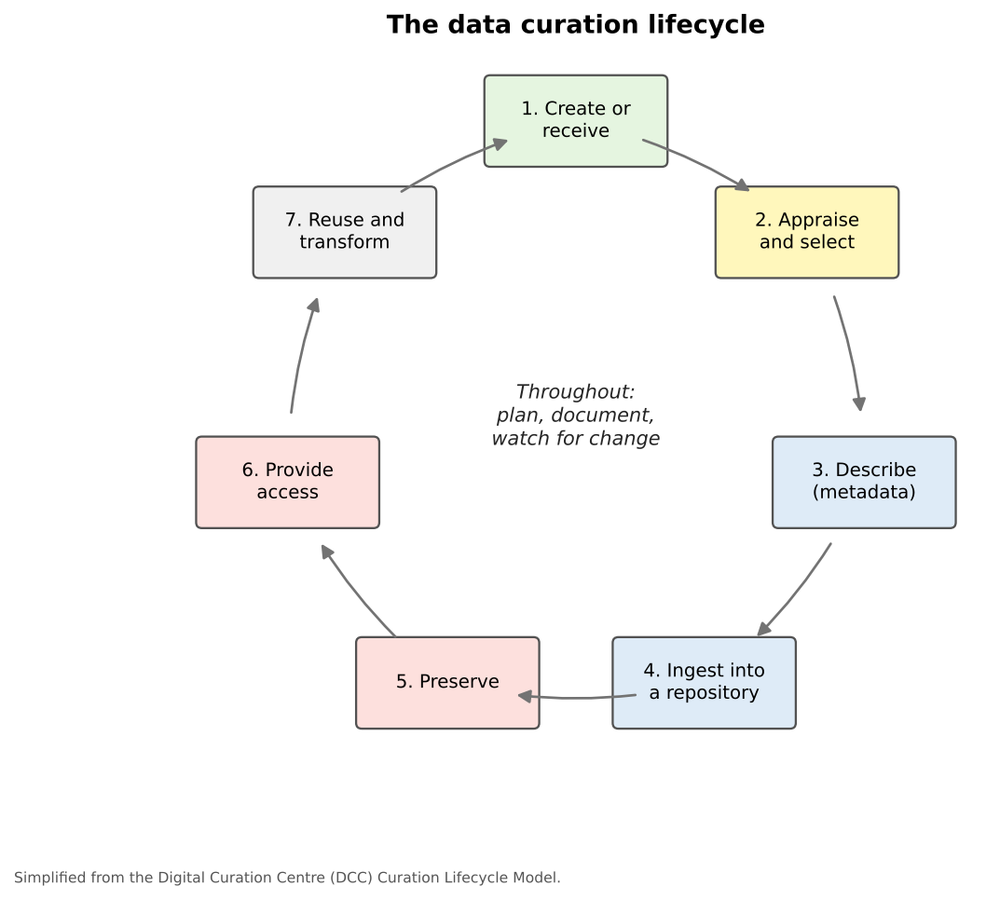

:::::::::::::::::::::::::::::::::::::: questions

- What is data curation, and how does it differ from data management and data cleaning?
- Why does curation matter for research, and for geospatial data in particular?
- What are the stages of the curation lifecycle?
- What do funders and federal policies now expect?

::::::::::::::::::::::::::::::::::::::::::::::::

::::::::::::::::::::::::::::::::::::: objectives

- Define data curation and explain its purpose
- Distinguish curation from data management and data cleaning
- Describe the stages of the curation lifecycle
- Explain how public access policies and the FAIR principles shape curation

::::::::::::::::::::::::::::::::::::::::::::::::

## What is data curation?

**Data curation** is the work of making data **understandable, trustworthy and reusable over the long
term**, by people who were not involved in creating it. It includes:

- describing data with **metadata** and **documentation**
- choosing formats and storage that will **last**
- depositing data in a **repository** where it can be found, cited and preserved
- deciding **who may access** the data and under what **license**
- protecting **sensitive information** before data is shared

A museum curator looks after objects so that future visitors can see and understand them. A data curator
does the same for datasets.

### Curation, management and cleaning

| | Data cleaning | Data management | Data curation |
|---|---|---|---|
| Goal | Correct errors in the data | Keep data organized, safe and usable **during** a project | Keep data understandable and reusable **after** the project, by others |
| Typical tasks | Fix typos, duplicates, missing values, invalid geometries | Folders, file names, versions, backups, quality checks | Metadata, documentation, preservation, repositories, licenses, access |
| Time frame | Days to weeks | The life of the project | Years to decades |
| Main audience | The analyst | The project team | Future users, including strangers |

The three overlap, and the **Data Management** module covers organizing, versioning and quality in detail.
This module focuses on what happens so that data can **outlive** the project that made it.

::::::::::::::::::::::::::::::::::::: callout

## Curation starts on day one

Curation is often left until a project ends, when the people who understood the data have moved on and the
details are forgotten. It is far easier to record where data came from, what each field means and what was done
to it **while** the work happens. Think of curation as a habit, not a final task.

::::::::::::::::::::::::::::::::::::::::::::::::

## Why curation matters

Poorly curated data leads to:

- **Lost data**: files on a former student's laptop, an expired cloud account, an unreadable format
- **Lost meaning**: a column called `pct2` that nobody can explain, or coordinates with no coordinate system
- **Irreproducible results**: published findings that cannot be checked because the exact data is gone
- **Wasted effort**: others collecting the same data again because they could not find or trust yours

Well-curated data, by contrast, can be **cited** (giving its creators credit), **verified**, **combined** with
other data, and **reused** for questions its creators never imagined. Census data collected in 1940, carefully
preserved, is still used by historians, demographers and geographers today.

### Geospatial data adds challenges

- Datasets are often **several files** (a shapefile) or **very large** (imagery, lidar)
- They are meaningless without their **coordinate reference system**
- **Boundaries change** (census tracts are redrawn every ten years), so the **date** of the geography matters
- Formats change quickly, and some are **proprietary**
- **Locations can identify people**, so sharing needs particular care

## The curation lifecycle

The UK's Digital Curation Centre (DCC) describes curation as a lifecycle. A simplified version:

{alt="A cycle of seven boxes connected by arrows: 1 Create or receive, 2 Appraise and select, 3 Describe (metadata), 4 Ingest into a repository, 5 Preserve, 6 Provide access, 7 Reuse and transform, which leads back to Create or receive. In the center: throughout, plan, document, watch for change."}

| Stage | What happens |
|---|---|
| **Create or receive** | Data is created by a project, or received from someone else, with its documentation |
| **Appraise and select** | Decide which data is worth keeping long term, and which can be discarded |
| **Describe** | Write metadata and documentation so others can find and understand it |
| **Ingest** | Deposit the data and documentation in a repository or archive |
| **Preserve** | Keep it safe, readable and unchanged: checksums, backups, format migration |
| **Provide access** | Make it findable and available, openly or under controlled access |
| **Reuse and transform** | Others use the data, perhaps creating new datasets that start the cycle again |

Around the whole cycle run **planning**, **documentation**, and **community watch**: keeping an eye on new
standards, formats and technologies that may require action.

### Appraisal: not everything needs to be kept

Keeping data costs money and effort. A useful set of questions for deciding what to curate:

- Is it the data **underlying a publication**, or required by a funder or journal?
- Is it **unique** or hard to recreate (field observations, historical records), or easily downloaded again
  (a public census table)?
- Is it likely to be **useful to others**?
- Can it be **shared legally and ethically**?

For data you downloaded from a stable public source, it is often enough to **cite** the source precisely
(including the version and date) and keep the code that processes it, rather than archiving another copy.

## Public access and FAIR

Expectations for sharing research data have grown quickly:

- **Funders** such as the National Science Foundation and the National Institutes of Health require a data
  management and sharing plan with proposals.
- A 2022 memorandum from the White House Office of Science and Technology Policy (the "Nelson memo") directed
  federal agencies to make publications from federally funded research, **and the data underlying them**,
  freely available without delay, and to use persistent identifiers and metadata. Agencies were asked to have
  updated policies in effect by the end of 2025.
- Many **journals** ask authors to share data, or to state where it can be found.

Behind these policies are the **FAIR principles** (published in 2016), which say research data should be:

| Principle | Means | In practice |
|---|---|---|
| **Findable** | People and computers can discover it | A persistent identifier (DOI), rich metadata, a searchable repository |
| **Accessible** | It can be retrieved, with clear conditions | Standard web access; metadata stays available even if the data is restricted |
| **Interoperable** | It works with other data and tools | Open formats, standard vocabularies, EPSG codes, standard identifiers such as GEOIDs |
| **Reusable** | Others can use it correctly | A clear license, detailed documentation and provenance |

FAIR does not mean "open": sensitive data can be FAIR with controlled access. The following episodes take each
part of curation in turn: **metadata**, **documentation**, **preservation**, **sharing**, and **ethics**.

::::::::::::::::::::::::::::::::::::: challenge

## Curation, management or cleaning?

Classify each task:

1. Removing 12 duplicate survey responses
2. Choosing a folder structure for a team project
3. Writing a description of each column for a dataset going into a repository
4. Converting a final dataset from a proprietary format to GeoPackage for archiving
5. Setting up nightly backups of the project drive

:::::::::::::::: solution

1. **Cleaning**
2. **Management**
3. **Curation** (documentation and metadata)
4. **Curation** (preservation), though choosing open formats is good management too
5. **Management**

The boundaries are fuzzy, and that is fine: what matters is that each task gets done.

:::::::::::::::::::::::::

::::::::::::::::::::::::::::::::::::::::::::::::

::::::::::::::::::::::::::::::::::::: challenge

## Keep or cite?

At the end of a project you have: (a) county boundaries downloaded from the Census Bureau, (b) grocery store
locations your team verified in the field, (c) a Python script that joins and analyzes them, and (d) 200 maps
exported while exploring the data. What would you curate and deposit, and what would you only cite or discard?

:::::::::::::::: solution

- **(a)** Cite precisely (product, year, URL, date accessed). It is already preserved by the Census Bureau.
- **(b)** Curate and deposit: it is unique, and recreating it would mean repeating the field work.
- **(c)** Deposit with the data: the code documents exactly how results were produced.
- **(d)** Keep only the maps used in publications; exploratory maps can be regenerated from (a) to (c).

:::::::::::::::::::::::::

::::::::::::::::::::::::::::::::::::::::::::::::

::::::::::::::::::::::::::::::::::::: keypoints

- Data curation makes data understandable, trustworthy and reusable over the long term by people outside the project
- Curation complements data management (during the project) and data cleaning (fixing errors)
- The curation lifecycle runs from creation through appraisal, description, ingest, preservation, access and reuse
- Funders and federal policy increasingly require data underlying publications to be shared
- FAIR data is findable, accessible, interoperable and reusable, which does not always mean open

::::::::::::::::::::::::::::::::::::::::::::::::
